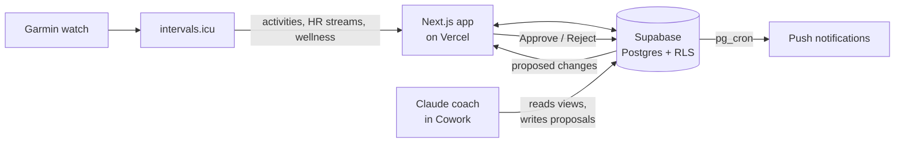

<div align="center">


# Trainer

**An AI personal trainer for marathon training, built around one rule:
automate the plumbing, never the judgment.**

Garmin data in, a Claude-powered coach plans the week, every change waits for a tap of approval.
Built for a 2027 marathon build: running, gym and recovery in one phone app.


</div>

---

## What it does

| | |
|---|---|
| **Today** | A 0–100 **readiness score** from last night's HRV, resting HR, sleep and training form, with 7 / 14 / 30-day trends. Today's session with one action, the last session in numbers, the week as rings, and a short "needs you" list. |
| **Plan** | The week as a calendar: done, planned, changed, proposed, missed. Tap a day for its sessions, km splits, watch laps and HR drift. The coach's proposals are approved here. |
| **Progress** | A **marathon time prediction** (race anchor + easy-run fitness + "marathon shape"), race-pace tracking, and running / body / gym stats with a plain-language read of what's on point and what to watch. |
| **Gym** | An offline-first workout logger: sets × reps @ RIR, progression suggestions (add weight, same weight, lower), deload weeks from the season plan, and targets you can edit by hand. |

## How it works



- **Sync:** Garmin → intervals.icu → `POST /api/sync` → activities, km splits, watch laps, HR-zone histograms and daily wellness (HRV, resting HR, sleep, fitness / fatigue).
- **The coach** is Claude, working as a personal trainer in a Claude Cowork project. It reads SQL views of the training data and writes **proposals only**: new sessions, changed sessions, gym templates and week rules, season versions.
- **You decide:** every proposal shows up in the app as a card with a before → after and the coach's reasoning, and only **Approve** applies it (atomically, in one Postgres function). Nothing changes by itself.
- **Guardrails, not gates:** load limits (ACWR, weekly ramp), 80/20 intensity, spacing rules and recovery warnings flag problems in red / amber and leave the decision to you. The same rules run in TypeScript and in SQL, checked against shared fixtures.

## The numbers behind it

- **Readiness:** HRV vs your 28-day normal (35%), sleep score (30%), resting HR vs normal (20%) and form = fitness − fatigue (15%). Bands: 80+ ready, 60–79 good, 40–59 easy, under 40 rest. Backtested on 120 days of real data before it went live.
- **Load:** session RPE × minutes (Foster), HR-based RPE for runs and cross-training, time in HR zones (Karvonen), acute : chronic workload ratio, monotony.
- **Marathon prediction:** Daniels VDOT from the latest race or time trial, calibrated with heart-rate VDOT on easy runs, scaled by weekly volume and longest run.
- **Strength:** estimated 1RM (Epley), hard sets per muscle per week, double progression at a target RIR.

Formulas, data model and every rule: [`docs/architecture.md`](docs/architecture.md).

## Tech stack

**Next.js 16** (App Router, server components) · **React 19** · **TypeScript** · **Tailwind CSS 4** · **Supabase** (Postgres, row-level security, Realtime, pg_cron, pg_net, Vault) · **Vercel** · **Web Push** (installable PWA) · **Recharts** · **Vitest** · **intervals.icu API** · **Claude** (via Claude Cowork + the Supabase connector)

## Run it yourself

It's built as a single-user app: your own Supabase project, your own Vercel deployment.

```bash
git clone https://github.com/tommm-mm/trainer.git
cd trainer
cp .env.example .env.local     # Supabase URL + anon key, intervals.icu key
npm install
npm run dev
```

1. Create a Supabase project and run the SQL files in `supabase/migrations/` in order.
2. Create your one user under *Authentication → Users*, then turn off sign-ups.
3. Add your intervals.icu API key (and, for notifications, VAPID keys) as env vars on Vercel.
4. Optional: set up the coach as a Claude Cowork project with the Supabase connector, using [`docs/coach/cowork-instructions.md`](docs/coach/cowork-instructions.md) as its instructions.

Checks: `npm test` · `npm run typecheck` · `npm run lint`

## Project layout

```
src/app/          screens: Today, Plan, Progress, Gym, Season, Recovery, Settings
src/lib/          pure logic, unit-tested: readiness, load, zones, race prediction,
                  gym progression, week checks, season model
supabase/         migrations: schema, RLS, views for the coach, proposal functions, push
docs/             architecture notes, coach instructions, UX notes
```

## Status

A personal project in active use for a 2027 marathon build. Next up: a "today's call" suggestion on low-readiness days, a weekly report card, and a travel mode.

## License

[MIT](LICENSE)
